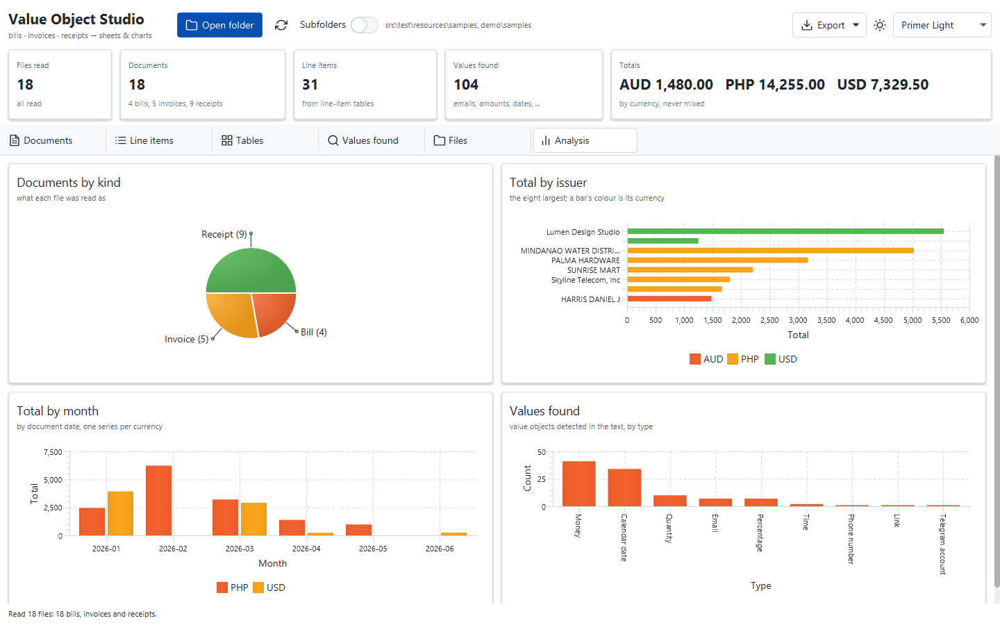
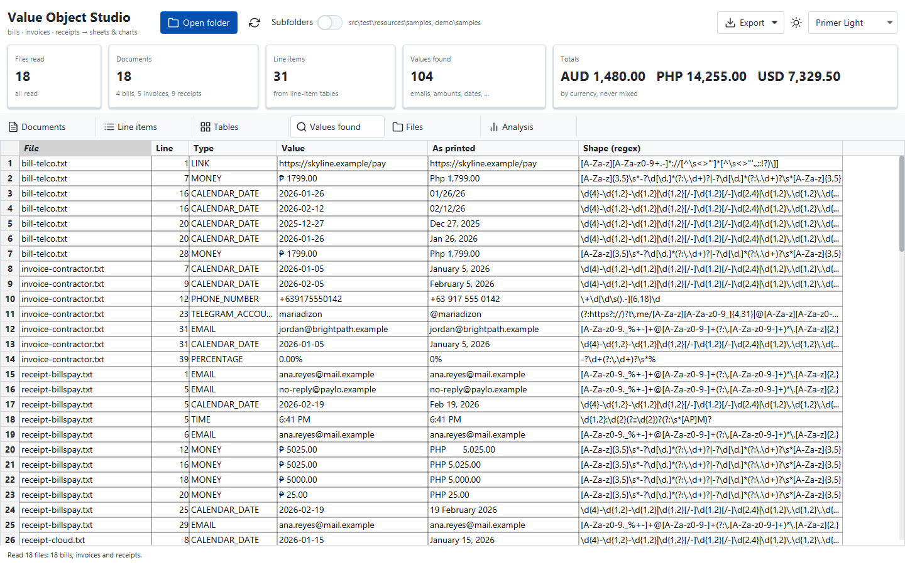

# value-object

Small, immutable, self-validating value objects for Java 25+, and the tools to find them in text: from a single
email address, to the tables in a page of OCR, to a whole bill, invoice or receipt.

```xml
<dependency>
    <groupId>io.joshuasalcedo</groupId>
    <artifactId>value-object</artifactId>
    <version>0.1.0</version>
</dependency>
```


## What is in it

| Package | Value objects |
|---|---|
| `contact` | `Email`, `PhoneNumber`, `Link`, `Address`, `FullName` (parses printed names: titles, suffixes, *dela Cruz*), `Party` |
| `financial` | `Money`, `Currency` (`FiatCurrency` ISO 4217, `CryptoCoin`), `Percentage`, `PaymentTerms` (Net 30, EOM, 2/10 Net 30, MFI, COD), `CardNumber` (Luhn, masked), `MaskedCard`, `Iban` (mod-97), `Bic`, `Bill`, `Invoice`, `Receipt`, `LineItem` |
| `measurement` | `UnitOfMeasure` (UN/ECE Rec 20 codes), `Quantity`, `Weight`, `Distance`, `FileSize` |
| `temporal` | `CalendarDate` (every printed form), `DateRange`, `Timestamp`, `DateTimeWithZone`, `Time`, `TimeZone`, `DurationNano` |
| `geo` | `Country`, `Continent`, `Language`, `Demonym`, `PostalCode`, `Coordinates` |
| `identifier` | `UniqueId`, `Slug`, `Username`, `DisplayName`, `JwtToken`, `TaxId` (PH TIN, EU VAT, US EIN), `Gtin` (EAN/UPC) |
| `network` | `IpAddress` (v4, v6), `MacAddress`, `Port`, `DomainName`, `OperatingSystem` |
| `file`, `table`, `visual`, … | `FileType`, `Table`, `Color`, `SemanticVersion`, `Gender`, … |

Every one implements `ValueObject`, validates itself when made (`ValueObjectException` when it is wrong), and is equal
by value. Optional parts are `Optional`, never `null`; lists are empty, never `null`.

## One way in: `ValueObject`

```java
// what is in a text
ValueObject.detect("Mail jane@example.com, call +63 917 555 0142");   // {EMAIL=1, PHONE_NUMBER=1}
ValueObject.find(text);                       // the values themselves, by type
ValueObject.scan(text);                       // each with the regex that matched it and where (Found)
ValueObject.identify("192.168.0.1");          // Optional[IPV4_ADDRESS]
ValueObject.parse("149.99 USD");              // Optional[Money]

// make one from anything its factories take
ValueObject.Parse.Money("149.99 USD");
ValueObject.Parse.Port(8080);
ValueObject.Parse.Quantity("2.5 kg");

// check anything; input that is not one fails, it never throws
ValueObject.Validate.MONEY.is.USD.test("149.99 USD");     // true
ValueObject.Validate.GENDER.is.MALE.test("male");         // true
ValueObject.Validate.EMAIL.valid.test("nope");            // false

ValueObject.Type.EMAIL.type();                // Email.class: every value object, listed
```

`ValueObject`, its `Type` list, `Parse` and `Validate` are **generated** from the value objects themselves and
`codegen/detection.txt` (the regex that recognises each one in text). After adding or changing a value object:

```sh
java codegen/GenerateValueObject.java           # rewrites ValueObject.java
java codegen/GenerateValueObject.java --check   # CI: fails if it is out of date
```

## Tables, bills, invoices and receipts

```java
List<Table> tables = ValueObject.tables(text);   // Tesseract TSV, positioned words, or plain text
Table t = tables.getFirst();
t.columns();                // [Item, Qty (numeric), Unit Price (MONEY), Contact (EMAIL)]
t.value(1, "Unit Price");   // Optional[Money]

BillingDocument doc = BillingDocument.parse(text);   // a Receipt, an Invoice or a Bill
doc.issuer();               // Party: name, Address, email, phone, tax id; person() reads it as a FullName
doc.lineItems();            // description, Quantity (with its UOM), unit price, amount
doc.total();                // Money; with no currency printed, the currency of the country it is from
doc.metadata();             // every other labelled value, as value objects where they are
doc.sources();              // how each field was read: its label, its line, its form on the page
if (doc instanceof Invoice inv) inv.dueDate();   // printed, or worked out from its terms (Net 30 EOM)
```

Columns are found where cells line up; the value objects in them name their types, join split columns
(`149.99` + `USD`) and tell the header row from the data.

## Images: OCR in the JVM

```java
try (Ocr ocr = Ocr.english()) {
    Receipt r = Receipt.parse(ocr.text(Path.of("receipt.png")));
}
```

`Ocr` runs Tesseract inside the JVM: no install, no Docker. Its native libraries come with
`org.bytedeco:tesseract-platform:5.5.0-1.5.11`, an **optional** dependency of this library: add it to use OCR. It needs
the English language data (`eng.traineddata`), found through `TESSDATA_PREFIX` or the usual install folders.

## CSV and JSON

```java
Json.pretty(doc);              // a document: its fields, lines, metadata, sources and found values
Csv.of(doc.lineItems());       // description,quantity,unitPrice,amount,other
Csv.of(ValueObject.scan(text));
table.toCsv();
```

Card numbers are always written masked.

## The demo: Value Object Studio

A desktop app (JavaFX, [AtlantaFX](https://github.com/mkpaz/atlantafx) themes,
[ControlsFX](https://controlsfx.github.io/) spreadsheets, [Ikonli](https://kordamp.org/ikonli/) icons) that reads a
folder (images through OCR, `.txt`/`.tsv` as they are) and shows what the library found:

| | |
|---|---|
|  |  |
| **Line items**, with quantities in their Rec 20 units | **Analysis**: by kind, by issuer and by month, never mixing currencies |
|  |  |
| **Values found**, each with the regex that matched it | **Tables** found in each file |

```sh
mvn install                        # the library, into ~/.m2
mvn -f demo/pom.xml javafx:run     # open the app, then open a folder (or drop one on it)
mvn -f demo/pom.xml javafx:run "-Djavafx.args=--folder samples --theme Dracula"   # open with a folder read
demo/screenshots.sh                # run it on the samples and save the screenshots above into image/
```

Every sample document is made up (fictional brands, people, addresses and numbers): the library's test documents in
`src/test/resources/samples` (HTML in `codegen/samples`, rendered and read back with OCR) and `demo/samples`.

## Build

```sh
mvn verify      # compile, test, sources and Javadoc jars
mvn install     # into ~/.m2
```

## Release

Push a tag `vX.Y.Z` (or run the **Release** workflow by hand with a version). The workflow sets the version, signs
every artifact and publishes to Maven Central.

Repository secrets it needs:

| Secret | What |
|---|---|
| `MAVEN_CENTRAL_USERNAME` / `MAVEN_CENTRAL_PASSWORD` | a Central Portal user token |
| `SIGNING_KEY` | an ASCII-armoured private PGP key |
| `SIGNING_KEY_PASSWORD` | its passphrase |

## License

Apache License 2.0.
